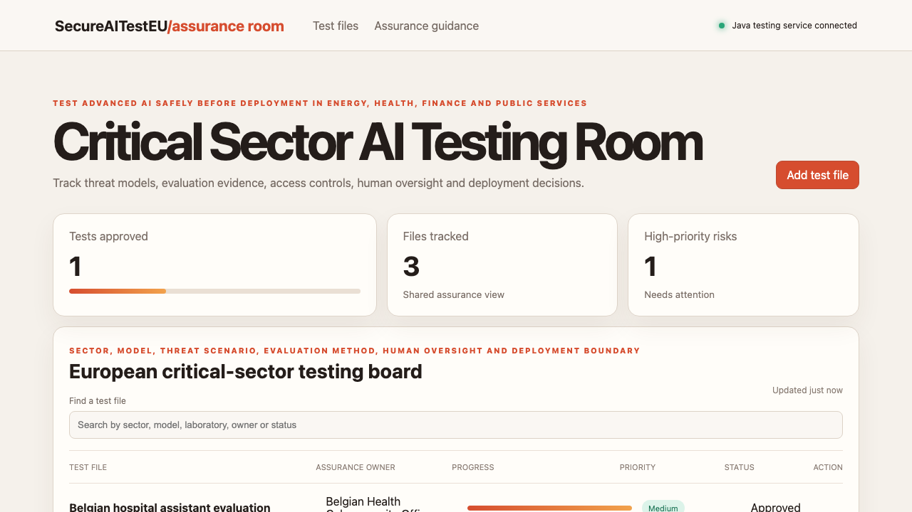

# Critical Sector AI Testing Room

## One-sentence benefit

Help critical-sector operators test advanced AI safely before deployment in essential services.

## Live demo

[Watch the workflow](docs/demo.webm).

## Screenshots

## Main features

- Search and sort test files by sector, model, laboratory or status.
- Create real test files through the Java API.
- Advance evaluations through draft, review and approved states.
- Show loading, empty, error and success feedback.
- Present operational and guidance sections responsively.

## Technology used

Angular, TypeScript, signals, HttpClient, SSR, Spring Boot and Java 21.

## Installation instructions

Install Node.js 22 and Java 21. Run `npm install`, start `cd backend && mvn spring-boot:run`, then run `npm start`.

## Commercial licensing/contact

Commercial licensing and integration support are available through the repository contact options.

## Business problem and users

Energy, health, transport, finance and public-service teams need secure evaluation evidence before advanced AI reaches operations.

## Key workflows

Find a test, add an evaluation file, review risks, advance approval and confirm the API result.

## Angular framework highlights

Signals provide derived state, OnPush change detection limits work, HttpClient performs real API writes and SSR remains configured.

## Java backend highlights

Spring Boot exposes validated list, search, create and update APIs, clear errors, health status and service tests.

## Architecture and state flow

Angular calls `/api/items`; Java validates requests and returns updated test files to signal-based state.

## Accessibility and responsive behaviour

Semantic sections, labelled search, visible focus styles and responsive work rows support keyboard and small screens.

## Verification commands

Run `npm test`, `npm run build`, `cd backend && mvn test` and `cd backend && mvn package`.

## Structure

`src` contains the frontend, `backend` contains Java and `docs` contains inspected media.

## Tradeoffs

In-memory records simplify local use; production needs secure model access, identity, persistence and evaluation integrations.

## Roadmap

Add benchmark suites, threat libraries, confidential results, model cards and deployment-boundary monitoring.
